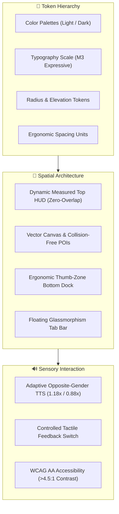

# B-Map Sovereign Mobile Design System & UI/UX Standards

> [!IMPORTANT]
> B-Map Native is India's sovereign satellite navigation application powered by ISRO NavIC (L5 + S-band dual constellation), Department of Posts DigiPIN 10-character geocoding, NHAI FASTag electronic toll telemetry, and real-time community V2X road hazard reporting.
> All screens, overlays, modals, and interaction states must adhere to this document.



---

## 1. Visual Hierarchy & Surface Elevation

The visual layout adheres to Material 3 Expressive guidelines, utilizing layered depth, high-contrast border outlines, and adaptive theme elevation.

### 1.1 Color Tokens & Sovereign Branding

| Token Name | Light Palette | Dark Palette | Semantic Function |
|---|---|---|---|
| `primary` | `#0061A7` | `#A1C9FF` | Primary navigation CTA, active highlights |
| `primaryContainer` | `#0096FF` | `#00487F` | NavIC status pills, active search indicators |
| `background` | `#F9F9FF` | `#0B132B` | Full-screen background base |
| `surfaceContainerLowest`| `#FFFFFF` | `#0A0F1A` | Floating search bars, modal cards, HUD panels |
| `surfaceContainerLow` | `#F0F3FF` | `#141D2E` | Secondary buttons, inactive chips, meta rows |
| `surfaceContainerHigh`| `#DEE8FF` | `#222D40` | Card borders, dividers, subtle separators |
| `trafficGreen` / `secondary` | `#00C06D` | `#66FEA3` | Smooth traffic, verified badges, live locks |
| `trafficOrange` / `tertiary` | `#FF9800` | `#FFB870` | Moderate congestion, warning radar, fuel stops |
| `trafficRed` / `error` | `#BA1A1A` | `#FFDAD6` | Heavy gridlock, road hazards, SOS alerts |
| `onSurface` | `#111C2D` | `#E0E4EF` | High-contrast primary headings and titles |
| `onSurfaceVariant` | `#3F4753` | `#BFC7D5` | Secondary body descriptions, timestamps, ETA |

### 1.2 Surface Outlines & Elevation Rules
- **No Invisible Dividers**: Every floating card, chip, or HUD must declare a distinct `borderWidth: 1` or `borderWidth: StyleSheet.hairlineWidth` with `colors.surfaceContainerHigh` or `colors.outlineVariant`.
- **Elevation Shadows**:
  - `Shadows.sm`: Used for environmental pills, chip toggles, and secondary buttons.
  - `Shadows.md`: Used for floating brand bars, compass icons, and floating controls.
  - `Shadows.lg`: Reserved for the bottom commute sheet, bottom tab bar, and modal cards.

---

## 2. Spatial Layout & Zero-Overlap Architecture

Mobile viewports must strictly avoid overlapping floating elements, clipped text, or colliding interaction touchables.

```
┌──────────────────────────────────────────────┐
│  Status Bar (Dynamic Island / Notch: 44pt)   │
├──────────────────────────────────────────────┤
│  Top Brand Bar (B-Map, NavIC, SOS, Bell, User)│
│  Floating Search Bar (Compass, Input, Mic, AR)│
│  Transit Mode Chips (Drive, Transit, Bike...) │
│  ─── TOP HUD MEASURED BOTTOM EDGE (topHudHeight)
├──────────────────────────────────────────────┤
│ [Weather Pill]             [Layers FAB]      │
│ [Camera Alert]             [Traffic FAB]     │
│                            [Compass FAB]     │
│                            [Locate Me FAB]   │
│                                              │
│          FULL VECTOR MAP VIEWPORT            │
│       (Collison-Free Center Quadrant)        │
│                                              │
├──────────────────────────────────────────────┤
│  Commute & Discovery Floating Bottom HUD     │
├──────────────────────────────────────────────┤
│  Floating Glassmorphism Tab Bar (62pt)       │
│  Safe Area Inset Bottom (insets.bottom: 34pt)│
└──────────────────────────────────────────────┘
```

### 2.1 Dynamic Top HUD Offset Formula
Never hardcode fixed `top: 130` or `top: 105` for floating map controls. The top cluster must measure its rendered pixel bounds dynamically:

```typescript
const [topHudHeight, setTopHudHeight] = useState<number>(0);
const floatingTop = topHudHeight > 0 ? topHudHeight + 10 : Math.max(insets.top + 172, 215);

<SafeAreaView
  edges={['top']}
  style={styles.floatingTopSafeArea}
  onLayout={(e) => {
    const { height } = e.nativeEvent.layout;
    if (height > 0 && Math.abs(height - topHudHeight) > 2) {
      setTopHudHeight(height);
    }
  }}
  pointerEvents="box-none">
  {/* BrandBar + SearchBar + TransitChips */}
</SafeAreaView>
```

### 2.2 Map POI Collision Prevention Rules
To ensure all map pins remain completely legible and never collide with floating UI controls:
1. **Right Margin Clearance**: Floating action buttons (Layers, Traffic, Compass, Locate Me) occupy `right: 16` to `right: 60`. Map POIs on the right side (such as `IFC Mall` or `B-Power EV`) must maintain a minimum offset of `right: 76` or be placed in the center quadrant (`left: '46%'` to `left: '52%'`).
2. **Left Margin Clearance**: Environmental widgets (Weather & Radar alerts) occupy `left: 16` to `left: 160` between $y = 200\text{--}280\text{pt}$. Map pins on the left must start below $y = 310\text{pt}$ (e.g. `Pothole · km 42` at `top: '34%'`, `Grand Metro Stn` at `top: '39%'`).
3. **Touch Targets**: All POI pins and map callouts must provide `hitSlop={{ top: 10, bottom: 10, left: 10, right: 10 }}` to guarantee instant finger selection without mis-taps.

---

## 3. Ergonomic Thumb-Zone Architecture

Critical driving, navigation, and safety actions are anchored in the accessible **Thumb Zone** (the bottom $35\%$ of the physical screen).

```
Thumb-Zone Reachability on Mobile Handsets:
┌────────────────────────┐
│  Top 25%: Hard to Reach│  → Context info, non-destructive titles
├────────────────────────┤
│  Center 40%: Natural   │  → Map canvas, route guidance overview
├────────────────────────┤
│  Bottom 35%: ONE-THUMB │  → Primary CTA ("Go", "Broadcast", "SOS"),
│     COMFORT ZONE       │     Bottom Dock, Floating Tab Bar
└────────────────────────┘
```

### 3.1 Docked Bottom Action Bars (`bottomDock`)
Every multi-step flow (e.g., `HazardReportScreen`, `TransitPlannerScreen`, `IndoorParkingScreen`) must dock its primary action button into a sticky bottom container:
- `position: 'absolute'`, `bottom: 0`, `left: 0`, `right: 0`.
- Padding bottom must account for dynamic home indicators:
  $$\text{paddingBottom} = \max(\text{insets.bottom}, 12) + 8\text{pt}$$
- Elevated with `Shadows.lg` and separated with a crisp `borderTopWidth: 1`.

---

## 4. Multi-Sensory & Adaptive Vernacular Interaction

### 4.1 Smart Voice Gender Pairing Engine
To provide maximum acoustic clarity and cognitive comfort across India's diverse linguistic landscape, voice prompts automatically adopt the opposite gender frequency:

$$\text{User Gender} = \text{Male } (\sigma^{7}) \implies \text{App Voice} = \text{Female } (\venus) \quad [\text{Pitch } 1.18\times, \text{ Rate } 0.98\times]$$
$$\text{User Gender} = \text{Female } (\venus) \implies \text{App Voice} = \text{Male } (\sigma^{7}) \quad [\text{Pitch } 0.88\times, \text{ Rate } 0.94\times]$$

- **Voice Engine Matching**: Feminine frequencies auto-match installed Indian voices (`kavya`, `veena`, `samantha`, `priya`, `shruti`, `aditi`, `lekha`, `ananya`). Masculine frequencies auto-match installed voices (`rishi`, `neel`, `ravi`, `arun`, `david`, `alex`).
- **Vernacular Dialects**: Localized prompt delivery across English, Bengali (বাংলা), Hindi (हिन्दी), Tamil, Telugu, Marathi, Gujarati, Kannada, Malayalam, Punjabi, Odia, and Assamese.

### 4.2 Tactile Vibration Policy
- Haptic vibration feedback is globally controlled via `haptics.ts` (`isVibrationEnabled`).
- By default, general task bar, chip clicks, and scroll gestures are silent and vibration-free to prevent device battery drain and unnecessary physical buzzing.
- Users can toggle haptic feedback in `ProfileScreen` under Settings.

---

## 5. Component Primitives & Specifications

### 5.1 Tactical Button (`Button.tsx`)
- Minimum touch target: $48\text{pt}$ height.
- Press physics: Micro-scaled spring contraction ($0.975\times$) with `FluidCurves.pressIn` ($120\text{ms}$).
- Accessible label required on all instances.

### 5.2 Sovereign DigiPIN Card
- Displays 10-character alphanumeric geocodes partitioned into standard readable chunks (e.g., `28J4-K8M2-9P`).
- High-contrast primary badge (`DigiPIN`) paired with $\pm0.8\text{m}$ NavIC accuracy metrics.
- One-tap copy to clipboard with instant feedback.

### 5.3 Flowstep Multi-Step Progress Tracker
- 3-step progress bar showing Category $\to$ Severity & Lane $\to$ Evidence & Verification.
- Active step highlighted with `colors.primaryContainer` and accent pill dot.
- Connected via clean animated divider lines (`colors.surfaceContainerHigh`).

### 5.4 Floating Glassmorphism Tab Bar (`AnimatedTabBar.tsx`)
- Floating pill structure with `maxWidth: 520\text{pt}` centered horizontally.
- Background rendered using native `BlurView` (`intensity={70}`, `tint="systemMaterial"`).
- Active tab indicated by an animated sliding pill with spring momentum transitions.

---

## 6. Accessibility & Quality Checklist (WCAG AA)

- [x] **Color Contrast**: All text on surfaces meets or exceeds $4.5:1$ contrast ratio ($>7:1$ on dark mode).
- [x] **Touch Ergonomics**: All interactives meet the $44\text{pt}$ minimum tap target boundary.
- [x] **Zero Overlap**: Floating top HUD offset dynamically calculated via `topHudHeight + 10`.
- [x] **Screen Reader Ready**: `accessibilityRole`, `accessibilityLabel`, and `accessibilityState` declared across all buttons, chips, and cards.
- [x] **Continuous Native Generation**: Native `android/` and `ios/` folders remain generated; all platform customizations are managed via `app.json` config plugins.
