# B Map — Application Flowcharts

> **Version:** 1.0 · **Last Updated:** 2026-10-26
> Visual diagrams of the primary user flows, data flows, and system interactions.

---

## 1. Application Boot Sequence

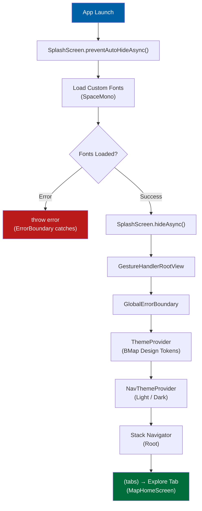

---

## 2. Main Navigation Flow

```mermaid
flowchart TD
    subgraph TABS["Bottom Tab Navigator"]
        T1["🧭 Explore<br/>(MapHomeScreen)"]
        T2["🛣️ Routes<br/>(RoutesScreen)"]
        T3["🏪 Nearby<br/>(NearbyScreen)"]
        T4["🚗 Services<br/>(ServicesScreen)"]
        T5["👤 Mine<br/>(ProfileScreen)"]
    end

    T1 -->|"Search bar tap"| S1["🔍 Search<br/>(SearchScreen)"]
    T1 -->|"AI button tap"| S2["🤖 AI Copilot<br/>(AiCopilotScreen)"]
    T1 -->|"Compass tap"| S3["🧭 Compass HUD<br/>(CompassHudScreen)"]
    T1 -->|"Navigate to place"| S4["🗺️ Turn-by-Turn<br/>(TurnByTurnNavModal)"]

    T2 -->|"Plan route"| S4
    T2 -->|"Multi-stop optimize"| S5["📦 TSP Optimizer<br/>(TspOptimizerScreen)"]

    T3 -->|"EV station tap"| S6["⚡ EV Station<br/>(EvStationScreen)"]
    T3 -->|"Parking tap"| S7["🅿️ Indoor Parking<br/>(IndoorParkingScreen)"]

    T4 -->|"Transit planning"| S8["🚇 Transit Planner<br/>(TransitPlannerScreen)"]
    T4 -->|"Fleet management"| S9["🚛 Vehicle Fleet<br/>(VehicleFleetScreen)"]
    T4 -->|"DigiPin lookup"| S10["📍 DigiPin Explorer<br/>(DigiPinExplorerScreen)"]

    T5 -->|"Not authenticated"| S11["🔐 Auth<br/>(AuthScreen)"]

    T1 -->|"SOS button"| S12["🆘 SOS Distress<br/>(SosDistressScreen)"]
    T1 -->|"Report hazard"| S13["⚠️ Hazard Report<br/>(HazardReportScreen)"]

    style TABS fill:#f0f3ff,stroke:#0061a7
    style S12 fill:#ba1a1a,color:#fff
    style S2 fill:#8b5000,color:#fff
```

---

## 3. Location Permission & GPS Flow

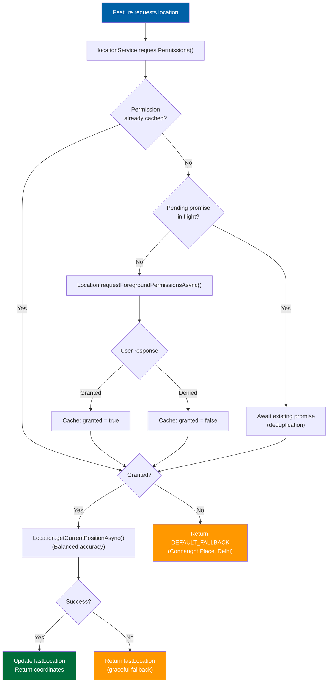

---

## 4. Live GPS Tracking Flow

```mermaid
flowchart TD
    A["Component mounts"] --> B["locationService.startLocationUpdates(callback)"]
    B --> C["Add callback to subscribers Set"]
    C --> D["Send cached lastLocation<br/>immediately (no UI stutter)"]
    D --> E{Permission<br/>granted?}
    E -->|No| F["Return false"]
    E -->|Yes| G{First subscriber?<br/>(subscribers.size === 1)}
    G -->|Yes| H["Location.watchPositionAsync()<br/>accuracy: High<br/>distance: 5m<br/>interval: 2500ms"]
    G -->|No| I["Reuse existing watcher"]

    H --> J["On new position"]
    I --> J
    J --> K["Update lastLocation"]
    K --> L["Notify all subscribers"]
    L --> J

    M["Component unmounts"] --> N["locationService.stopLocationUpdates(callback)"]
    N --> O["Remove callback from Set"]
    O --> P{Set empty?}
    P -->|Yes| Q["subscription.remove()<br/>Stop GPS watcher"]
    P -->|No| R["Keep watcher running<br/>for remaining subscribers"]

    style A fill:#0061a7,color:#fff
    style Q fill:#ba1a1a,color:#fff
    style H fill:#006d3b,color:#fff
```

---

## 5. Turn-by-Turn Navigation Flow

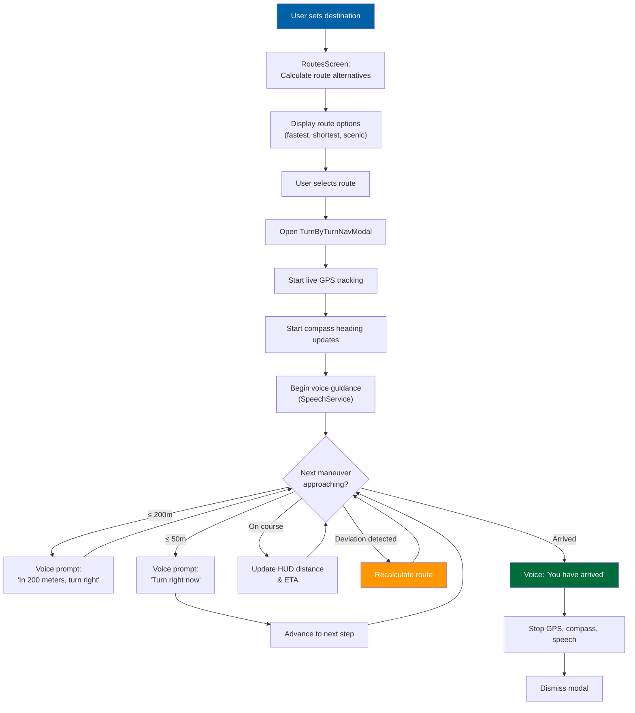

---

## 6. Search & DigiPin Flow

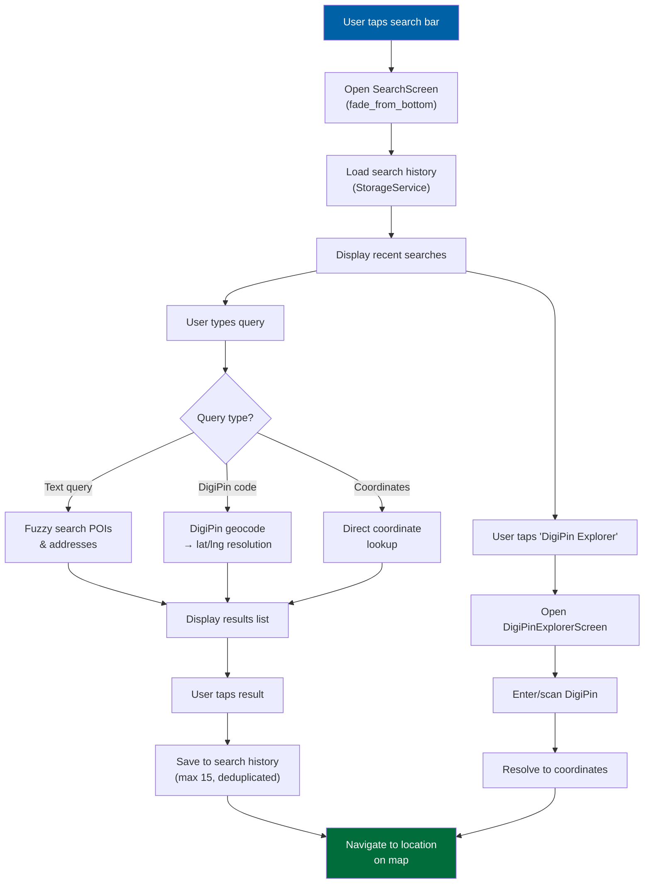

---

## 7. EV Charging Station Flow

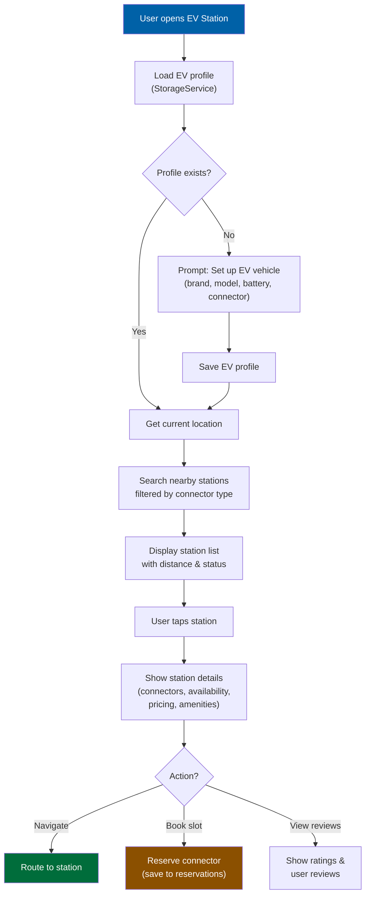

---

## 8. SOS Distress Emergency Flow

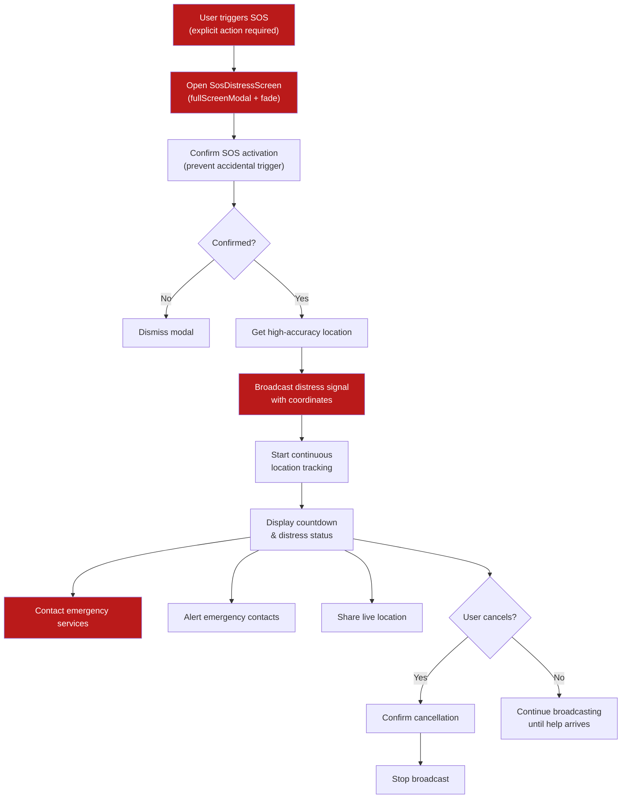

---

## 9. Storage & Caching Strategy Flow

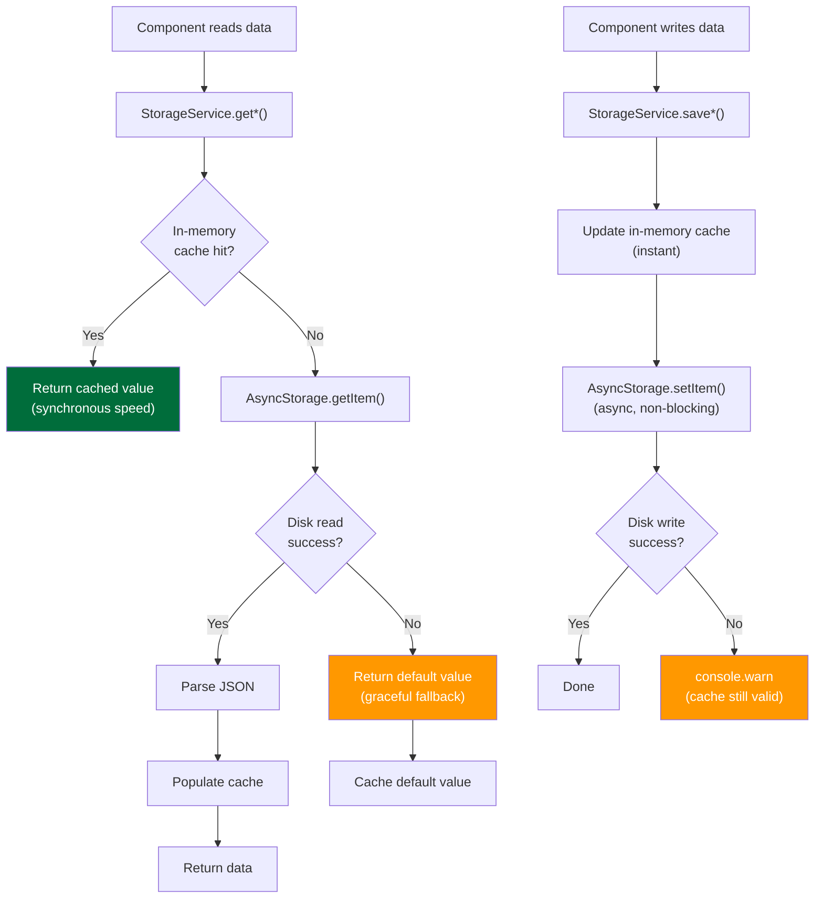

---

## 10. Theme Switching Flow

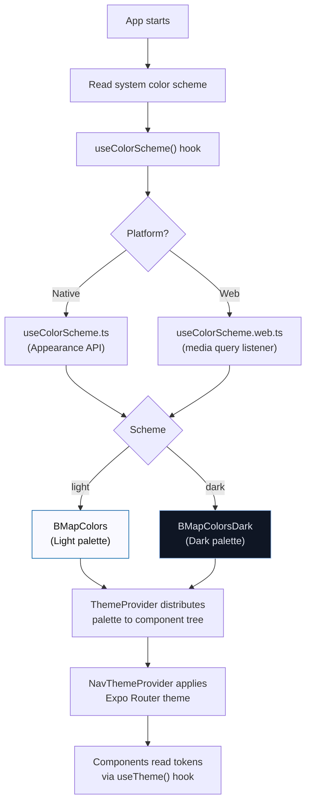

---

## 11. Feature Module Architecture Pattern

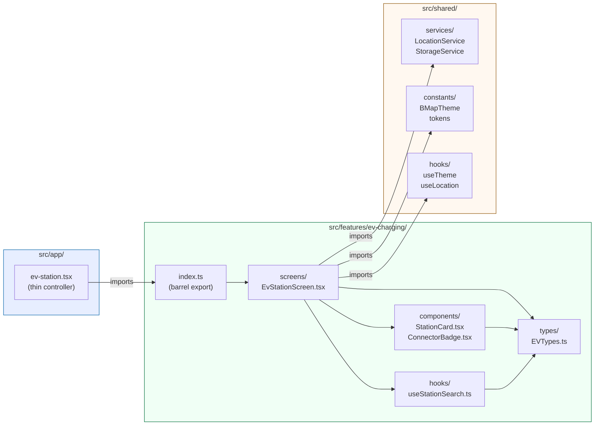

---

## 12. Fleet & TSP Optimization Flow

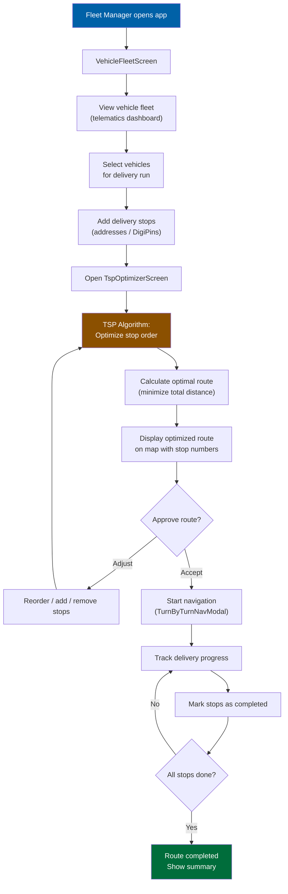

---

## 13. Indoor Parking Flow

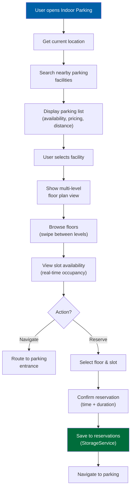

---

## 14. Public Transit Planning Flow

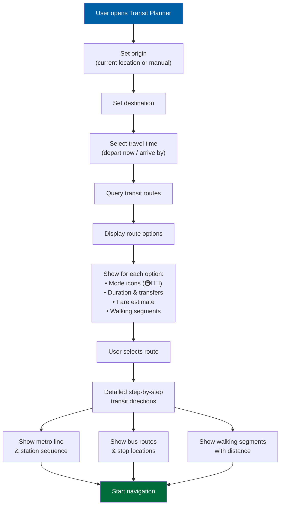

---

## 15. AI Copilot Voice Interaction Flow

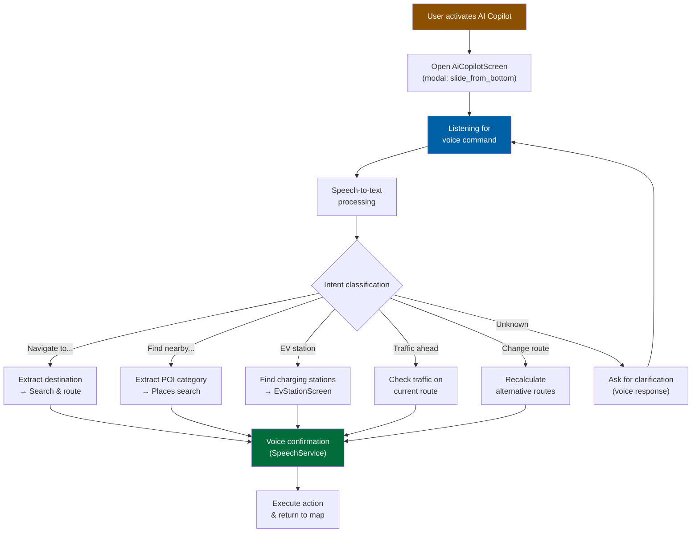

---

## 16. Dynamic App Icon & Compass Heading Synchronization Flow

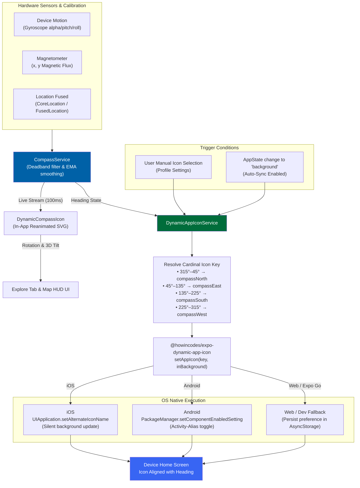
